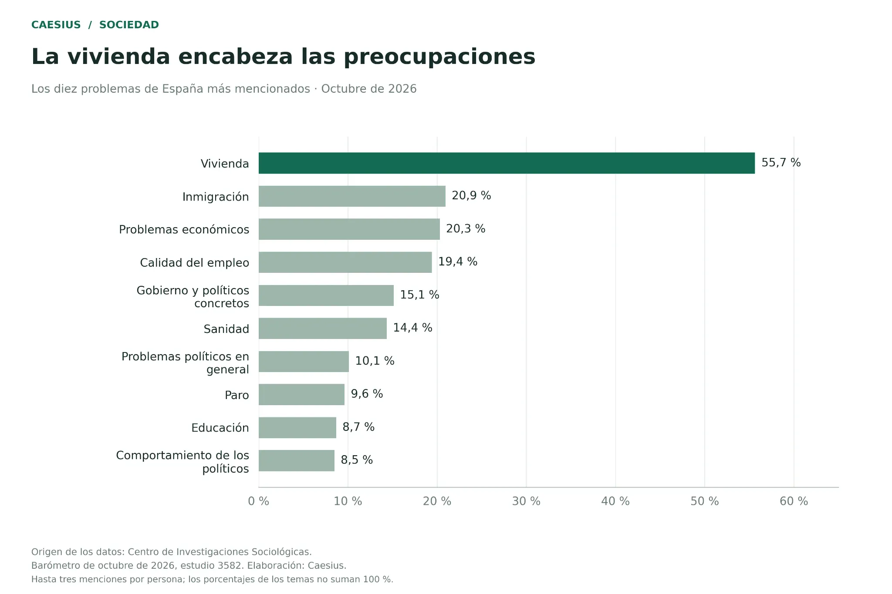
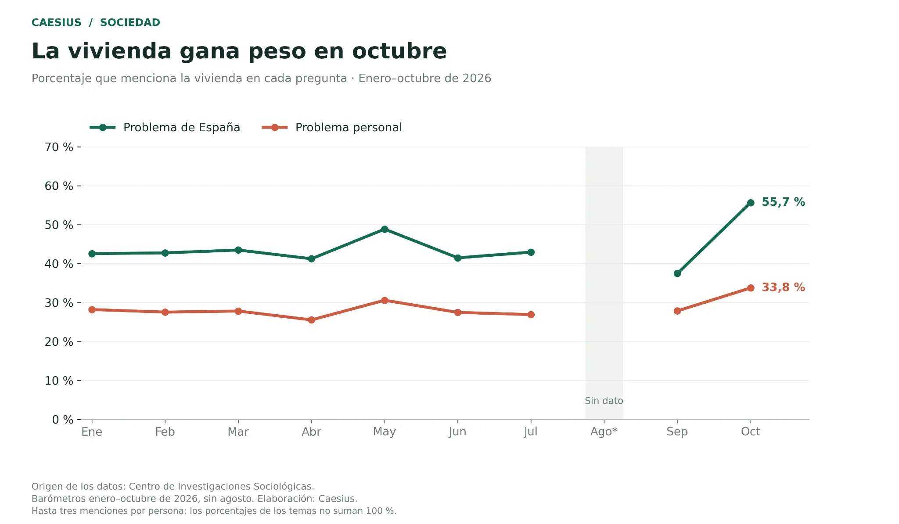
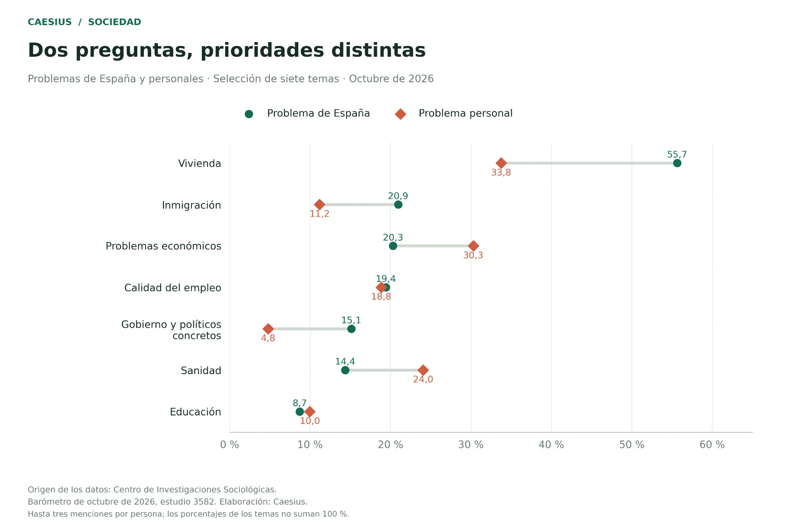
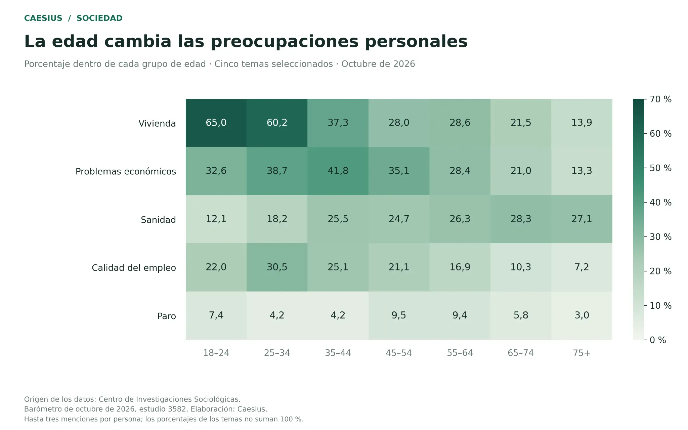
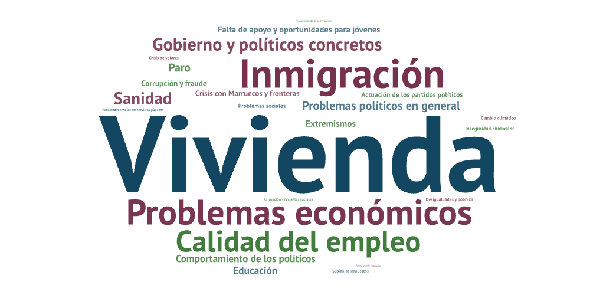

# ¿Qué temas preocupan a los españoles?

Análisis de las preocupaciones por España y de los problemas que afectan personalmente a la población entrevistada, con especial atención a las diferencias por edad. Proyecto de Ana García para **Caesius**.

[Leer el artículo en Caesius](https://caesius.vercel.app/analisis/preocupaciones-espanoles)

Repositorio: [byanagarez/preocupaciones-espanoles-hasta-oct2026](https://github.com/byanagarez/preocupaciones-espanoles-hasta-oct2026).

Este repositorio contiene el análisis y sus resultados. Los Excel originales del CIS no se distribuyen aquí; deben descargarse de la fuente para repetir el preprocesado. El código de la web de Caesius tampoco forma parte del repositorio.

## Qué analiza este proyecto

El trabajo combina nueve barómetros del Centro de Investigaciones Sociológicas (CIS) de enero a octubre de 2026. Las comparaciones de temas y edad corresponden a octubre; la evolución utiliza los nueve meses disponibles. Agosto no tiene observación y no se ha estimado.

Las preguntas distinguen entre los problemas de España y los que afectan personalmente a quien responde. Se utiliza el total de menciones entre hasta tres respuestas, no únicamente el primer problema citado.

Los resultados describen preocupaciones expresadas. No miden directamente la gravedad de los problemas ni demuestran sus causas.

## Fuente y materiales de partida

**Origen de los datos: Centro de Investigaciones Sociológicas.** Se utilizaron tabulaciones públicas XLSX, no microdatos individuales. Acceso a los estudios: [web del CIS](https://www.cis.es/), mediante los siguientes identificadores.

| Mes de 2026 | Estudio | Archivos de partida |
| --- | --- | --- |
| Enero | 3540 | `3540-multi.xlsx`, `3540-multi_abs.xlsx` |
| Febrero | 3544 | `3544-multi.xlsx`, `3544-multi_abs.xlsx` |
| Marzo | 3546 | `3546-multi.xlsx`, `3546-multi_abs.xlsx` |
| Abril | 3557 | `3557-multi.xlsx`, `3557-multi_abs.xlsx` |
| Mayo | 3562 | `3562-multi.xlsx`, `3562-multi_abs.xlsx` |
| Junio | 3567 | `3567-multi.xlsx`, `3567-multi_abs.xlsx` |
| Julio | 3571 | `3571-multi.xlsx`, `3571-multi_abs.xlsx` |
| Septiembre | 3577 | `3577-multi.xlsx`, `3577-multi_abs.xlsx` |
| Octubre | 3582 | `3582-multi.xlsx`, `3582-multi_abs.xlsx` |

Los ficheros `multi` contienen porcentajes verticales; los `multi_abs`, valores absolutos. Se descargaron y conservaron los pares mensuales dentro de `datos_originales`. Los sufijos de descarga como `(1)` no identifican estudios diferentes.

## Proceso realizado

### 1. Preparación del entorno

Se creó una carpeta de proyecto en Windows y se trabajó desde VS Code. Se utilizó un entorno virtual `.venv` para instalar las dependencias y se seleccionó su intérprete como kernel del notebook.

La primera preparación utilizó pandas y openpyxl para los Excel. Los gráficos definitivos del notebook utilizan Matplotlib y la biblioteca WordCloud; NumPy se utiliza como apoyo al análisis.

### 2. Lectura de los barómetros

El script `preprocesamiento.py` localiza los pares de archivos, identifica el estudio y el mes, y busca las preguntas sobre problemas de España y personales. La localización se basa en los textos y encabezados, porque la numeración de las preguntas y la posición de las tablas pueden cambiar entre meses.

Se distinguen las primeras, segundas y terceras respuestas de la columna total. Para el artículo se utiliza esta última. El detalle por orden de mención queda en una tabla separada.

Los cruces disponibles incluyen sexo, edad, estudios, tamaño de municipio, recuerdo de voto, ocupación, clase social, ideología y religiosidad. Se incorpora además una única dimensión general para el total nacional: no se suman los totales repetidos en las distintas hojas.

En marzo se detectó una hoja del archivo de absolutos cuyo nombre no correspondía al contenido. La dimensión se identifica mediante el encabezado interior de la tabla, evitando depender exclusivamente del nombre de la pestaña.

### 3. Limpieza y estructura común

Se transformaron las tablas con encabezados múltiples en registros con una estructura común. Cada registro identifica estudio, mes, tipo de problema, dimensión, grupo, categoría y porcentaje. Se conserva también el archivo, hoja y fila de origen.

Los porcentajes se mantienen en escala 0–100 y con la precisión disponible en los XLSX. Los archivos CSV se guardan con codificación UTF-8 con BOM, separador de punto y coma y coma decimal, para facilitar su apertura en Excel en español.

Se conservan los porcentajes ponderados publicados. Los absolutos redondeados no se utilizan para reconstruirlos y no se aplica una segunda ponderación. Las bases ponderadas pueden contener decimales: no deben interpretarse como recuentos de entrevistas sin ponderar.

Las categorías originales se mantienen. En las figuras se acortan algunas etiquetas para mejorar la lectura, sin fusionar temas. «No sabe», «No contesta», «Ninguno» y «Otras respuestas» no se muestran como preocupaciones sustantivas; no se elimina su peso del denominador ni se reparte entre otros temas.

### 4. Controles de calidad

Se verificó la cobertura de meses, la ausencia de duplicados en las claves de análisis y el rango de los porcentajes. Se identificaron copias idénticas de archivos mediante su huella SHA-256 para no procesarlas por duplicado. Se conservaron las notas originales de los estudios y la cobertura temporal de cada categoría.

El preprocesado produjo **91.773 registros de menciones totales** y una selección de **8.484 registros de edad y total general**. Son filas de tablas agregadas: **no son personas entrevistadas**. El detalle de los órdenes de mención contiene 362.199 registros.

Los resultados de control quedan en `control_calidad.json`. Una categoría ausente en un mes no se transforma en cero. En la evolución, agosto se incorpora al eje como un hueco y la línea se interrumpe.

### 5. Exploración y selección de historias

El script `comparar.py` permitió revisar el ranking de octubre, los porcentajes de vivienda por edad y la serie mensual. Después se trabajó en `Preocupaciones_espanoles.ipynb` para comparar ambas preguntas y preparar los gráficos.

Se eligieron cuatro comparaciones principales: ranking de problemas del país, evolución de la vivienda, distancia entre problemas nacionales y personales, y diferencias por edad. Los cambios entre porcentajes se expresan en puntos porcentuales y se calculan antes de redondear.

### 6. Creación de los gráficos

El notebook final guarda cada gráfico como PNG a 300 ppp y SVG, junto con el CSV de los datos utilizados, dentro de `imagenes_definitivas`. Los valores visibles se redondean a un decimal; los CSV conservan la precisión de trabajo.

Se utilizaron títulos explicativos, una paleta coherente, la fuente del CIS y la identificación de Caesius como responsable de la elaboración. Se retiró la referencia provisional a «borrador».

### 7. Diseño de la nube de temas

La versión final de la nube incluida aquí se diseñó en [WordArt](https://wordart.com/) con una lista de los 25 temas más mencionados como problemas de España en octubre. Cada fila contenía un tema completo y su porcentaje como peso, separados por punto y coma.

Se mantuvo el formato CSV y se desactivaron la eliminación de palabras comunes, la eliminación de números y el stemming. Se evitó repetir categorías y se abreviaron etiquetas sin sumar ni fusionar sus porcentajes.

Esta nube representa categorías del CIS ponderadas por sus porcentajes, no un análisis de las palabras literales de las respuestas. Los colores son decorativos, no representan grupos ni otra variable. La nube facilita una primera impresión; el ranking permite comparar cifras con mayor precisión.

El notebook incluye una alternativa reproducible con WordCloud y exporta `05-nube-wordart.csv`. La composición manual de WordArt es distinta de la generada por Python; no se presenta como una reproducción exacta del notebook.

### 8. Comunicación de resultados

El análisis se trasladó a un artículo de opinión basado en evidencias, publicado en Caesius y enlazado al principio de este documento. Se separaron las interpretaciones editoriales de las afirmaciones demostrables con la encuesta. Este repositorio reúne los datos procesados, el código de análisis y las figuras finales; no incluye el proyecto de la web.

## Los cinco gráficos

### 1. Ranking de problemas de España



La vivienda aparece en el 55,7 % de las respuestas, frente al 20,9 % de la inmigración, el 20,3 % de los problemas económicos y el 19,4 % de la calidad del empleo. Se muestran los diez primeros temas. No se suman categorías políticas que podrían ser mencionadas por las mismas personas.

### 2. Evolución de la vivienda



Entre septiembre y octubre, la vivienda como problema del país pasa del 37,5 % al 55,7 %: un aumento de 18,2 puntos porcentuales. Como problema personal pasa del 27,9 % al 33,8 %, unos 5,9 puntos más. Agosto queda sin dato. La comparación describe el salto, pero no identifica su causa.

### 3. Problemas nacionales frente a personales



La vivienda tiene más presencia en la pregunta nacional, mientras que economía y sanidad pesan más en la personal: 30,3 % y 24,0 %, respectivamente. La comparación no indica qué combinaciones respondió cada persona ni mide intensidad de preocupación.

### 4. Problemas personales por edad



La vivienda alcanza el 65,0 % entre 18 y 24 años y el 60,2 % entre 25 y 34, frente al 13,9 % entre personas de 75 o más años. Los problemas económicos alcanzan su máximo entre 35 y 44 años y la calidad del empleo entre 25 y 34. El mapa utiliza una escala común de 0 a 70 %.

### 5. Nube de los 25 temas principales



Origen de los datos: Centro de Investigaciones Sociológicas. Barómetro de octubre de 2026, estudio 3582. Selección y elaboración: Caesius; composición visual realizada con WordArt. El peso de cada categoría corresponde a su porcentaje nacional de menciones.

## Contenido del repositorio

| Archivo | Función |
| --- | --- |
| `README.md` | Contexto, proceso, resultados, fuentes y límites |
| `.gitignore` | Lista cerrada de archivos que se publican |
| `requirements.txt` | Dependencias de lectura, análisis y visualización |
| `preprocesamiento.py` | Extrae y unifica las tabulaciones originales, si se descargan |
| `comparar.py` | Consulta rankings, edades y evolución desde la tabla limpia |
| `Preocupaciones_espanoles.ipynb` | Análisis explicado y generación de imágenes |
| `datos_limpios/preocupaciones_total.csv` | Tabla principal, suficiente para ejecutar el notebook y las comparaciones |
| `datos_limpios/control_calidad.json` | Resumen de validaciones y cobertura |
| `datos_limpios/cobertura_categorias.csv` | Presencia temporal de categorías, no prevalencia |
| `datos_limpios/notas_fuente.json` | Notas originales de las tabulaciones |
| `datos_limpios/fuentes.csv` | Procedencia, nombres y huellas de los archivos de origen |
| `figuras/` | Las cinco imágenes finales utilizadas en este README |

Quedan fuera del repositorio `.venv`, `datos_originales`, `imagenes_definitivas`, las copias de scripts, `LEEME.md`, `VALIDACION.txt`, las tablas derivadas redundantes y los archivos de la web. El `.gitignore` limita expresamente los archivos que se añaden; no los borra del ordenador. Las imágenes y CSV exportados al ejecutar el notebook pueden generarse de nuevo y no necesitan duplicarse en GitHub.

La tabla principal conserva las distintas dimensiones extraídas, aunque el artículo utiliza el total general y la edad. No se modifica el esquema que esperan el notebook y los scripts.

## Cómo ejecutar el análisis

Desde la raíz del proyecto:

```powershell
python -m venv .venv
.\.venv\Scripts\python.exe -m pip install -r requirements.txt
.\.venv\Scripts\python.exe comparar.py
```

Si el entorno ya existe, omite su creación. Abre `Preocupaciones_espanoles.ipynb`, selecciona el kernel de `.venv` y ejecuta las celdas en orden. No hace falta descargar los originales ni repetir el preprocesado para trabajar con el CSV limpio incluido. El notebook guarda PNG, SVG y CSV en `imagenes_definitivas`, una carpeta excluida de Git.

### Para repetir también el preprocesado

Descarga del CIS los pares XLSX indicados en la tabla de estudios, crea localmente `datos_originales` y colócalos dentro conservando sus nombres. Después ejecuta:

```powershell
.\.venv\Scripts\python.exe preprocesamiento.py
```

Este paso regenera `datos_limpios`, incluidos archivos auxiliares que no se publican por ser redundantes para el análisis. Revisa el control de calidad y las notas antes de interpretar los resultados. Los originales permanecen fuera de GitHub.

La nube final publicada se conserva en `figuras/05-nube.png`. El notebook genera una alternativa de WordCloud y una lista para WordArt; el diseño manual de la nube no se reproduce exactamente con Python.

## Límites de interpretación

- Las respuestas múltiples no suman 100 %. Tampoco se deben sumar porcentajes entre meses, grupos o categorías que pueden solaparse.
- Las tabulaciones son agregadas: no permiten reconstruir personas ni obtener cruces conjuntos como edad por sexo.
- Diferencias entre edades en octubre no equivalen a cambios de una generación a lo largo del tiempo.
- No se han calculado pruebas de significación ni intervalos de confianza. Las diferencias pequeñas no se presentan como concluyentes.
- La codificación y agrupación de temas poco frecuentes puede variar entre estudios. Las etiquetas parecidas no se fusionan automáticamente.
- La ausencia de agosto o de una categoría no se interpreta como cero.
- La preocupación por la vivienda no identifica por sí sola situación residencial, capacidad de emancipación o esfuerzo económico. Esas cuestiones requieren otras fuentes.

## Cita y reutilización

**Origen de los datos: Centro de Investigaciones Sociológicas.** Barómetros de enero, febrero, marzo, abril, mayo, junio, julio, septiembre y octubre de 2026, estudios 3540, 3544, 3546, 3557, 3562, 3567, 3571, 3577 y 3582. [CIS](https://www.cis.es/).

Los datos se reutilizan conforme a las condiciones del CIS y al [aviso legal de datos.gob.es](https://datos.gob.es/es/aviso-legal). Deben conservarse los documentos originales y sus metadatos de actualización y reutilización. Si el documento original incluye una fecha de última actualización, debe mencionarse al citarlo; no se sustituye por la fecha de descarga o por propiedades técnicas del Excel.

El tratamiento, las visualizaciones y las interpretaciones corresponden a Caesius. El CIS no participa, patrocina ni respalda este análisis. Estas condiciones se refieren a los datos de origen y no asignan por sí mismas una licencia al código o a los textos del proyecto.
